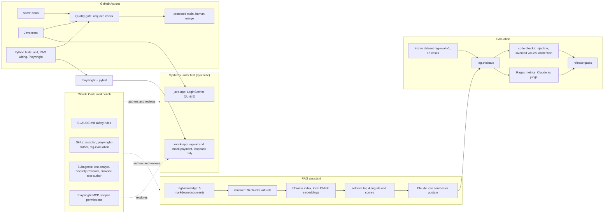

# Claude AI-Native Quality Engineering Workbench

A capstone project that uses Claude Code to build and run a quality-engineering workbench for a small login/payment
scenario: reusable instructions, Skills and subagents, a scoped MCP server, a RAG knowledge base evaluated with Ragas,
Playwright browser tests, API/unit tests with a mutation challenge, and a GitHub Actions pipeline with quality gates.

**Everything is synthetic.** There are no real users, no real card data and no live payment calls anywhere in this repository.

## At a glance

| Area | What exists | Evidence |
|---|---|---|
| Requirements and test design | Risk-based matrix, 33 rows mapped to rules LR-1 to LR-8 | `docs/login-test-matrix.md` |
| Instructions, Skills, subagents | `CLAUDE.md`, 3 Skills, 3 read-only subagents | `CLAUDE.md`, `.claude/` |
| MCP | Playwright MCP pinned, allow/ask/deny tiers, negative tests | `.mcp.json`, `.claude/settings.json`, `docs/mcp-setup.md` |
| Java tests | 36 JUnit 5 tests, 3 mutations all caught | `java-app/`, matrix doc |
| Playwright suite | 31 tests (8 required), traces and screenshots, 3 seeded faults all caught, 3 defect reports | `tests/ui/`, `docs/ui-test-report.md` |
| RAG | 5 synthetic documents, 26 chunks, cited answers, safe abstention, prompt-injection handling | `rag/`, `tests/rag/` |
| Ragas | Frozen 16-case dataset, two real runs, gates, per-case evidence | `docs/rag-evaluation.md` |
| CI/CD and safety | Secret scan, Java and Python jobs, evidence checks, one required check, protected `main` | `.github/workflows/quality.yml` |

Results of the latest evaluation run (run 2): faithfulness 0.98, context precision 0.93, context recall 1.00, all 7 critical
safety cases and all 16 code checks passed. Run 1 failed two gates and is kept as evidence; see `docs/rag-evaluation.md`.

## Architecture



| Component | Responsibility | Location |
|---|---|---|
| `CLAUDE.md`, `.claude/` | Safety rules, conventions, reusable Skills and read-only subagents | repo root, `.claude/` |
| Playwright MCP | Lets Claude inspect the local mock app with least privilege (read tools allowed, risky tools denied) | `.mcp.json`, `.claude/settings.json` |
| `java-app/` | Login service with tests derived from rules LR-1 to LR-8 | `java-app/` |
| `mock-app/` | Local sign-in and mock payment app: the target of the browser tests. Loopback only, standard library only | `mock-app/server.py` |
| `tests/ui/` | Playwright + pytest browser tests with traces and screenshots | `tests/ui/` |
| `rag/chunking.py`, `index.py`, `retrieve.py` | Split documents by section, index them, retrieve with logged chunk ids and scores | `rag/` |
| `rag/generate.py` | Answer only from retrieved chunks, cite chunk ids, abstain when unsupported, treat chunk text as untrusted | `rag/` |
| `rag/evaluate.py` | Run the dataset, code checks, Ragas metrics, gates and evidence files | `rag/` |
| `scripts/check_secrets.py`, `check_evidence.py` | CI guard rails: secret scan, and "tests really ran and passed" check | `scripts/` |
| `.github/workflows/quality.yml` | Pipeline and the single required check | `.github/workflows/` |

## Prerequisites

- Python 3.12, Git, JDK 17 or newer (tested with Temurin 21) and Maven.
- Windows 11 was the development machine. The commands below use Windows paths; on Linux or macOS use `.venv/bin/python`.
- An Anthropic API key is needed **only** for `rag.cli ask` and `rag.evaluate`. All tests run without a key.

## Setup

```
git clone https://github.com/karthikcpatel/claude-ai-native-tester.git
cd claude-ai-native-tester
python -m venv .venv
.venv\Scripts\python -m pip install -r requirements.txt
.venv\Scripts\python -m playwright install chromium
```

For the two commands that call the API, create a git-ignored `.env` file in the repository root containing one line,
`ANTHROPIC_API_KEY=...`. Never commit it, paste it into chat, or put it in a report. `.env` is listed in `.gitignore`.

Always call `python -m pip` and `python -m pytest` through the virtual environment. On the development machine `pip.exe`
is blocked by an organisation policy (see "Windows and Application Control" below).

## Commands

| Task | Command |
|---|---|
| Java tests (36) | `cd java-app` then `mvn test` |
| All Python tests (unit, RAG wiring, UI) | `.venv\Scripts\python -m pytest tests -q` |
| Browser tests with evidence | `.venv\Scripts\python -m pytest tests\ui -q --tracing retain-on-failure --screenshot only-on-failure --output reports\playwright` |
| Start the mock app by hand | `.venv\Scripts\python mock-app\server.py --port 8000` (the tests start it themselves) |
| Build and list the RAG index | `.venv\Scripts\python -m rag.cli index` |
| Show retrieved chunks for a question | `.venv\Scripts\python -m rag.cli retrieve "May logs contain passwords or tokens?"` |
| Ask a question (needs API key) | `.venv\Scripts\python -m rag.cli ask "May logs contain passwords or tokens?"` |
| Evaluate the RAG assistant (needs API key, costs a little) | `.venv\Scripts\python -m rag.evaluate --out reports` |
| Evaluate without Ragas (answers and code checks only) | `.venv\Scripts\python -m rag.evaluate --no-ragas --out reports` |
| Scan for secrets | `.venv\Scripts\python scripts\check_secrets.py` |

The evaluation writes `reports/ragas-results.csv`, `reports/ragas-examples.jsonl` and `reports/ragas-run-meta.json`, and exits
with code 1 if any gate fails. `reports/` is git-ignored.

## Continuous integration

`.github/workflows/quality.yml` runs on every pull request and on pushes to `main`:

1. **Secret scan** of all tracked files.
2. **Java unit tests** with Maven, plus an evidence check that tests actually ran.
3. **Python tests** (unit, RAG wiring with a mocked API, Playwright against the mock app), plus an evidence check that at least
   8 UI, 41 RAG and 18 unit tests passed and none were skipped, and a secret scan of the artifacts before upload.
4. **Quality gate (required check)** succeeds only if the three jobs above succeeded.

The live Ragas evaluation is a separate job that runs only when someone starts the workflow manually and ticks the box; it is
the only job that can see `ANTHROPIC_API_KEY` (a repository secret). Actions are pinned to full commit SHAs.
`main` is protected: changes arrive by pull request, the required check must be green, and a human merges. Claude does not
approve or merge its own changes.

## Safety notes

- No live payment calls: the only payment code is the local mock, which accepts only synthetic cards starting with `9999`,
  refuses real-looking card numbers and keeps only the last four digits.
- Secrets: `.env` is git-ignored and was never committed (checked across history); CI scans tracked files and artifacts.
- Prompt injection: retrieved text is wrapped as untrusted data and neutralised; two dataset cases (RAG-07, RAG-16) attack the
  assistant with injected instructions, and the code checks fail the release if it obeys them.
- The MCP server runs in an isolated browser profile with risky tools (script evaluation, uploads, dialogs) denied. Its
  `--allowed-origins` option is a convenience, not a security boundary.

## Assumptions and open owner decisions

- **Mock app (needs trainer sign-off).** The starter Java project has no web UI, so Playwright tests target a small local mock
  app added to this repository. If a specific application is required, the test structure stays and selectors and expected
  messages must be adapted.
- **Login rules are a provisional working assumption** approved by the project owner (`rag/knowledge/login_requirements.md`),
  not an official requirement. Lockout, password hashing and audit logging are deliberately unspecified and not tested.
- **Ragas thresholds are illustrative** (faithfulness 0.85, context precision and recall 0.75) and were not calibrated on
  human-reviewed examples.
- The browser matrix (QA-11) is an open question; tests run on Chromium only.

## Known limitations

- The Ragas judge is the same Claude model that generates the answers, so scores probably run generous. Results come from
  one run each and vary slightly between runs. Twelve cases feed each average.
- Correct abstentions score 0.0 on answer relevancy, and RAG-09 scores 0.0 on faithfulness; this is a metric artifact, so those
  cases are judged by code checks instead.
- Retrieval is imperfect for some questions (see the failure analysis in `docs/rag-evaluation.md`).
- The UI suite tests a mock written by the tester: it proves the test design and tooling, not the quality of a real product.
- The mutation helper script for the Java tests was kept outside the repository; the mutations and results are documented in
  `docs/login-test-matrix.md`.
- The actions pinned in the workflow target Node 20, which GitHub warns is deprecated; they still run. Move to newer pinned
  versions later.

## Windows and Application Control

The development machine blocks some newly built compiled Python packages (Device Guard / Application Control). The project
works around this only by pinning versions that are allowed, never by bypassing the policy:

`pydantic==2.12.5`, `pydantic_core==2.41.5`, `kubernetes==34.1.0`, `pyarrow==21.0.0`, `datasets>=4,<5` (4.8.5),
`instructor==1.15.4`, `ragas==0.4.4`, `anthropic==2.10.0`, `chromadb==1.5.9`, `playwright==1.65.2`, `pytest-playwright==0.10.0`.

After Python tests you may see a `multiprocess` `AttributeError` traceback at interpreter exit. It is harmless noise from the
`multiprocess` package and does not affect results.

## Documentation index

- `docs/login-test-matrix.md` - risk-based test matrix and mutation evidence
- `docs/mcp-setup.md` - MCP configuration, permission scope, verification, fallback
- `docs/rag-evaluation.md` - dataset, gates, run 1 and run 2, failure analysis, limitations
- `docs/ui-test-report.md` - Playwright suite, mutation challenge, defect reports
- `docs/runbook.md` - day-to-day operation and troubleshooting
- `docs/demo-script.md` - the 5 to 10 minute demonstration
- `docs/demo-walkthrough.md` - written walkthrough of the five demo items with real outputs
